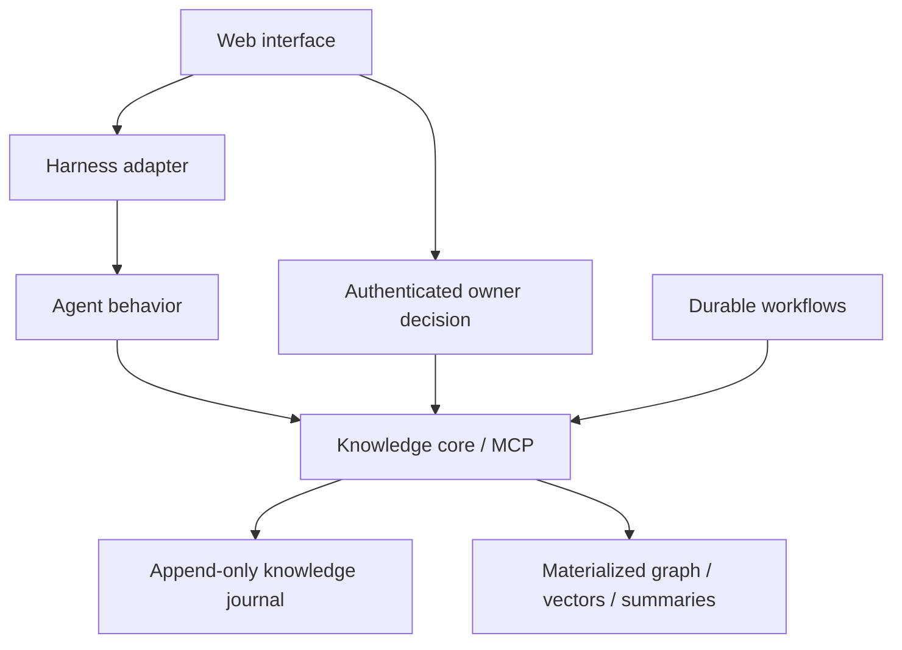

# Architecture

- [Accueil opérationnel autorisé](decisions/0024-authorized-operational-home.md) — catégories, dénominateurs et droits distincts.

Implémentation UX du16 octobre : [brief factuel](decisions/0021-factual-work-brief.md), [brouillon privé de contribution](decisions/0022-private-contribution-drafts.md), [références dossier/tâche sans transfert d’accès](decisions/0023-case-task-references.md). Les migrations et recettes de cette fenêtre sont synthétiques ; voir le [journal](../product/openbrain-autonomous-2026-10-16.fr.md).

Status, 5 October 2026: distinguish the implemented candidate below from the original target boundaries. The [audit](../product/code-audit-2026-10-05.fr.md) and [open decisions](open-decisions.md) identify runtime, persistence, workflow and frontend convergence choices. No production replacement is implied.

## Implemented working-tree architecture

Latest local correction: [ADR 0015 — bounded literal context passages](decisions/0015-bounded-literal-context-passages.md) fixes whole-body budget exclusion without changing published concepts. Semantic retrieval and the remaining audit decisions stay open.

Next access boundary selected: [ADR 0016 — browser sessions and independent human confirmation](decisions/0016-browser-session-and-human-confirmation.md). This is an implementation plan for AUD-01/05, not a delivered login or owner publication flow.

Its implementation in `services/browser-gateway` now includes OIDC code/PKCE, bounded one-use attempts, an ASGI session boundary, a reviewed console API proxy and a local launcher, tested against synthetic issuers/core responses. The console now has an opt-in cookie/CSRF adapter and a local dev/preview relay with component and HTTP tests. Full authenticated integration, Chrome, renewal, real provider and production topology are still pending; manual login remains the default.

| Component | Current role | Limit |
|---|---|---|
| `apps/console` | Actual React mock/API console; conversations, governance reads, BrainMap and sources | Manual browser identity; two spatial readers; incomplete import/review/publication journeys |
| `services/core` | Python compatibility reference and PostgreSQL core | Lexical/extractive subset, not the full semantic/biomimetic model |
| `services/rust-core` | Native API/MCP candidate used by new BrainMap recipes | Runtime choice not finalized; semantic runtime and consolidation incomplete |
| PostgreSQL | Journal, approvals, publication manifests, permissions and derived graph read tables | Full-version materialization and global rights checks affect cold cost |
| TerminusDB | Private immutable snapshots activated through the SQL publication manifest | Cold/memory and multi-version operating costs require qualification |
| `apps/harness` / companion | Client adapters and feedback/synthesis integration | External identity and autonomous harness loop not fully qualified |
| `services/workflows`, `packages/agents`, `apps/web` | Original planned boundaries | These directories are not evidence of completed workers/agents/product UI; existing file workers live elsewhere |

Contracts, authorization, provenance and human decisions remain core responsibilities. Read models and caches must not become independent authorities. Existing ADRs describe publication safeguards; the October audit recommends incremental projections and one navigation contract without discarding those safeguards.

## Original v0.5 target boundaries

The following diagram/table preserve the original decomposition. They do not state that every component is implemented or that Python is the only executable candidate. See the [accepted first slice](decisions/0001-executable-core.md) for its historical scope.

The authenticated owner path is distinct from agent tools. The harness may relay an owner decision but may not mint that decision or hold approval credentials.

| Component | Owns | Boundary |
|---|---|---|
| `services/core` | Domain model, proposals, approvals, journal, versions, materialization, provenance | Independent Python service; sole authority for trusted knowledge |
| `services/workflows` | Ingestion, extraction orchestration, fidelity checks, consolidation, scheduling | Uses core contracts; does not bypass approval or write trusted tables directly |
| `packages/agents` | Answering, evaluation, extraction, reporting behavior | Python modules independent of the chosen harness |
| `apps/harness` | Runtime integration, model adapters, conversation trajectories | TypeScript adapter; trajectories do not replace the knowledge journal |
| `apps/web` | Chat, sources, domain map, owner review, brief | TypeScript interface; owner actions are authenticated and validated by the core |
| `packages/contracts` | Protocol schemas, errors, examples, versioning | Shared wire boundary between Python and TypeScript |

## Knowledge flow

Source → candidate proposal → fidelity and risk checks → owner approval → appended change → materialized state → sourced answer and episode → feedback or gap → new proposal.

An accepted change becomes visible only when its retrieval indexes are ready. Responses identify the version actually served. Consolidation must preserve the approval boundary and provide a consistent state to readers.

## Technology baseline from the dossier

Python for the core and workflows; TypeScript for harness and interface. The proposed storage baseline is PostgreSQL with AGE and pgvector; the dossier also specifies Temporal, MCP, and AG-UI. The named harness is DeepSeek Harness / Cordis with a thin isolation adapter.

These are imported design selections, not verified dependencies. Confirm exact upstream identity, compatibility, licenses, and pinned versions before adding package manifests or infrastructure. See [open decisions](open-decisions.md) and source architecture (source import pending).
