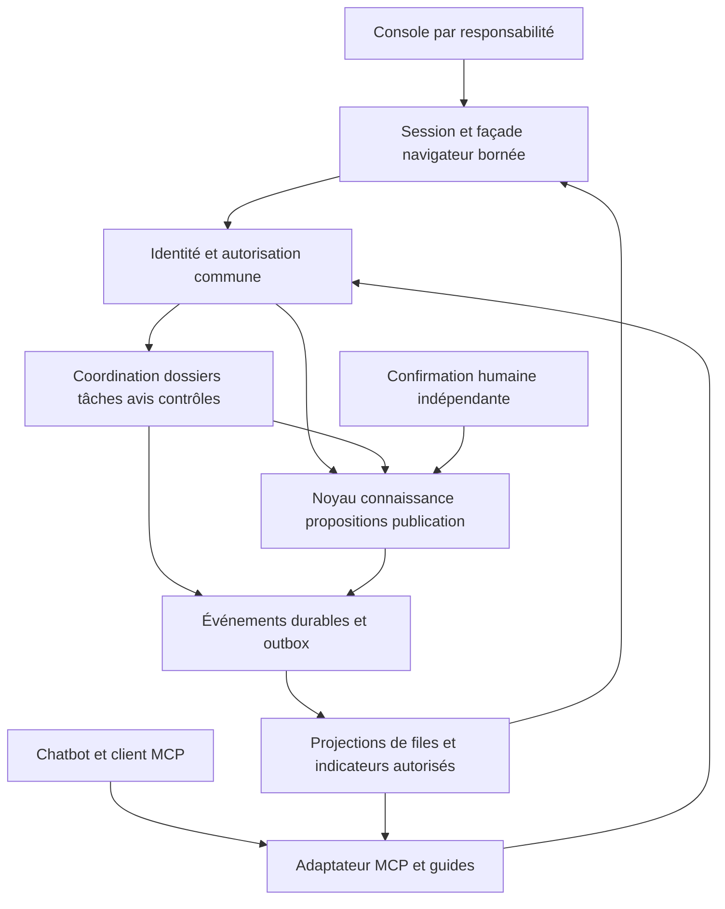

# Open Br**AI**n — besoins frontend et backend de la nouvelle expérience

**Actualisation du 16 octobre :** le [layout à conversation centrale](openbrain-chat-central.fr.md) définit désormais la composition et la parité des actions chat/UI. Les contenus et garanties ci-dessous restent applicables.

16 octobre 2026. **Contrats de conception proposés**, pas modification des contrats générés ou de l’API actuelle. Les noms d’opérations ci-dessous sont des noms logiques à stabiliser ; les routes et schémas existants restent la vérité d’exécution jusqu’à migration. Références : [UC](openbrain-use-cases.fr.md), [écrans](openbrain-screen-spec.fr.md), [audit](code-audit-2026-10-05.fr.md), [confirmation et session](../architecture/decisions/0016-browser-session-and-human-confirmation.md).

## 1. État constaté et frontières à préserver

Lecture ciblée du 16 octobre, sans audit exhaustif ni nouvelle recette : `/v1/me` renvoie une liste de domaines avec un `role` et des capacités conditionnelles (`server.rs`). Le validateur console connaît owner, corpus_manager, contributor, agent et viewer ; il ne connaît pas de rôle d’administration globale. Les propositions et la publication gouvernée existent. Les issues/signaux actuels sont personnels, y compris vis-à-vis de l’owner. Le suivi frontend d’import est partiel. Des sessions navigateur et un accès personnel loopback évitent désormais la saisie de tenant/JWT ; ils ne complètent pas les écrans owner ni la confirmation humaine indépendante.

Le frontend ne doit pas inventer de capacités à partir d’un label de rôle. Conserver le noyau de connaissance, les sources, identités et événements existants ; ajouter une couche de coordination métier et des projections de lecture. Une réécriture du moteur ne répondrait pas à elle seule aux besoins d’affectation/partage/suivi.

Cette vue est une décomposition de responsabilités, **pas une obligation de microservices**. Commencer par modules isolés dans les frontières existantes ; extraire un service seulement si contraintes de charge, sécurité ou exploitation le justifient. Une projection de dashboard ne devient jamais source d’autorisation.

## 2. Conventions communes de contrat

### Enveloppe de lecture

Toute lecture paginée restitue `items`, `next_cursor`, `has_more`, `as_of`, `scope`, `permissions_version` et `completeness` (`complete|partial|unknown`). `total` n’est fourni que si exact et autorisé ; sinon absent avec raison, pas zéro. Le curseur fige tri/filtres/périmètre/version et possède une expiration. Un curseur expiré demande de recommencer explicitement. Ordre stable `(date, id)` ; pagination sans doublon et tests de concurrence. Les agrégats sont calculés côté serveur sur les mêmes objets visibles que leur détail.

### Enveloppe de commande

Entrée : `command_id` idempotent, acteur dérivé de la session, scope vérifié, cible et `expected_revision`, charge utile métier, confirmation quand requise. Ne jamais faire confiance à un `actor_id` fourni par le navigateur. Sortie : `receipt_id`, `command_id`, état `accepted|running|succeeded|failed|needs_confirmation`, cible/révision et effets durables. Une absence de réponse côté client signifie **inconnu**, pas `failed`.

Même clé + même charge → même résultat ; même clé + charge différente → conflit explicite. Conservation des reçus au moins pendant la fenêtre documentée de reprise ; cette durée doit être fixée avec la politique de rétention. Transition + événement + outbox dans la même transaction logique. Les appels moteur hors transaction utilisent une tentative durable et une réconciliation, jamais un succès anticipé. Les commandes sensibles ne sont pas automatiquement répétées.

### Erreurs métier

| Code logique | Réaction UI/MCP |
|---|---|
| `authentication_required` | Masquer privé, rétablir session, reprendre lecture |
| `not_accessible` | Message neutre ; pas de fuite d’existence |
| `revision_conflict` | Relire version puis comparer, préserver brouillon autorisé |
| `validation_failed` | Erreurs par champ + résumé, aucune mutation partielle silencieuse |
| `precondition_failed` | Précondition nommée (source, revue, confirmation, version) |
| `capacity_limited` | Limite explicite, prochaine action ; pas de faux signal de lacune |
| `operation_pending` | Reçu durable, consultation de progression |
| `service_unavailable` | Diagnostic sûr et reprise de lecture ; commande à vérifier |

Les adaptateurs HTTP/MCP traduisent la même sémantique. Les détails SQL, tokens, prompts et contenus privés ne sont pas inclus dans les erreurs publiques. Les correlation IDs techniques ne contiennent pas de données métier.

## 3. B01 — Identité, capacités et cumul de rôles

**Écrans :** E01/E21/E24. Nouveau modèle cible : membership `(tenant, subject, domain, roles[], revision)` et rôles techniques globaux/tenant distincts. `capabilities[]` exprime les fonctions réellement disponibles et autorisées. `workspace_contexts[]` expose des combinaisons affichables. Le rôle choisi peut être transmis comme contexte d’audit, jamais comme preuve d’autorisation.

Migration additive : ancien `role` devient un ensemble à un élément ; conserver la compatibilité de lecture jusqu’au basculement des clients ; aucune duplication de membership par domaine ni élévation implicite. Définir séparément union des capacités et contraintes de séparation des tâches (auteur/reviewer/owner). Les refus et préconditions s’appliquent après union. Test combinatoire des rôles et déni inter-tenant obligatoire.

Opérations cibles : lire contextes ; lire capacités par objet ; préparer changement de membership ; prévisualiser effets sur tâches ; confirmer changement ; relire droits. Maintenir version d’autorisation pour invalider caches, curseurs et projections. Publication relit toujours les droits actuels. Retrait d’un accès cache immédiatement les objets concernés ; notifications et agrégats sont aussi filtrés. Le retrait du dernier owner nécessite une politique explicite, sans décision par défaut de cette spécification.

## 4. B02 — Tâches, affectations et délégation

**Écrans :** E02/E03/E06/E08/E21. Modèle minimal :

| Champ | Sens et contraintes |
|---|---|
| `id`, `tenant_id`, `domain_id`, `corpus_id?`, `revision` | Identité et concurrence ; corpus ne remplace pas domaine de droits |
| `type`, `title`, `objective`, `exit_criteria[]` | Correction, avis, diagnostic, revue de thème ; résultat contrôlable |
| `origin_refs[]`, `evidence_refs[]`, `target_refs[]` | Références typées, ACL relues, pas de copies de conversation |
| `requester`, `assignee?`, `assignment_id?` | Acteurs traçables ; un responsable actif proposé/accepté à la fois |
| `priority`, `priority_reason`, `due_at?` | Priorité métier explicable ; dates UTC et affichage fuseau |
| `created_at`, `first_signal_at?`, `assigned_at?`, `accepted_at?`, `last_activity_at` | Âges séparés ; aucun reset artificiel |
| `status`, `blocked_reason?`, `resolution?` | Machine d’états, motif de clôture et critères |
| `proposal_refs[]`, `review_refs[]`, `run_refs[]` | Plusieurs résultats possibles ; pas d’équivalence tâche/proposition |
| `visibility_policy`, `history_cursor` | Vue d’équipe autorisée et journal |

Machine proposée (D01/D05 à arrêter) :

| Depuis | Commande | Vers | Garde et effet |
|---|---|---|---|
| À affecter | proposer affectation | Proposée | Manager/owner, assigné éligible et preuves disponibles |
| Proposée | accepter | En cours | Assigné, révision courante, événement d’acceptation |
| Proposée | refuser | À affecter | Assigné, motif ; ancienne proposition conservée |
| En cours | bloquer | Bloquée | Assigné, cause et responsable attendu |
| Bloquée | reprendre | En cours | Cause levée, motif tracé |
| En cours | soumettre résultat | En attente de revue | Résultat lié et critères vérifiables |
| En attente de revue | demander modification | En cours | Reviewer/coordinateur selon type ; demande conservée |
| En attente de revue | clore | Terminée | Responsable de clôture, critères/résolution satisfaits |
| État non terminal | annuler | Annulée | Coordinateur, motif, travaux déjà produits conservés |
| Terminée/annulée | rouvrir | À affecter ou En cours | Autorité de clôture, motif, responsable explicite |

**Clarification de la version initiale :** « À qualifier » concerne le dossier B03 ; une tâche n’existe qu’après décision de travail. La vue globale peut afficher les deux phases, mais le modèle ne fusionne pas leurs statuts. Nouvelle affectation ne réinitialise ni âge initial ni échéance sans décision tracée.

Opérations : liste filtrée autorisée, détail, créer, proposer/reprendre affectation, accepter/refuser, bloquer/reprendre, soumettre résultat, clore/rouvrir, événements. Une tâche peut être autonome, sans signal. Les notifications sont émises par outbox, jamais avant la transaction.

## 5. B03 — Dossier partagé et frontière personnelle

**Écrans :** E07/E17/E23. Le signal personnel existant reste protégé. Introduire un `SharedCase` indépendant : id, scope, qualification, extrait partageable, références de signal autorisées, cible de feedback (`retrieved_evidence|delivered_answer|client_behavior`), origine explicite/observée/inférée, premier événement, récurrence dédupliquée, consentement/politique/version, destinataires, état et résolution.

Créer le dossier requiert une action/politique de partage explicite. Les extraits sont minimisés et séparés des conversations. Le manager ne reçoit jamais un droit de lecture implicite sur le signal brut. Un lien interne ne doit pas permettre de contourner cette séparation. Les vues déclarant et équipe sont des DTO distincts ; le DTO déclarant ne contient pas les notes, noms ou sources internes non autorisés.

Transitions : nouveau → à qualifier → besoin de contexte / orienté / tâche liée / clos sans changement. La branche corrigée passe par proposition/pub/recontrôle avant clôture avec preuve. Doublon = relation vers dossier canonique + conservation de provenance/âge ; pas de suppression d’événements. Retrait du partage révoque le contenu partagé suivant la politique définie, sans supprimer aveuglément les obligations d’audit minimal. Durées et motifs de conservation sont un arbitrage D09.

Opérations : préparer/consentir partage, qualifier, demander contexte, rapprocher, créer tâche liée, préparer conclusion partageable, clôturer, lire son suivi. Un feedback explicite négatif actuel et une issue `disputed_answer` ne sont pas automatiquement la nouvelle file d’équipe. Prévoir une migration **opt-in**, pas une publication rétroactive des issues personnelles.

## 6. B04 — Propositions, brouillons et avis d’expert

**Écrans :** E04/E05/E15. Réutiliser proposition/révision/diff/source actuels. Ajouter lien tâche et `ExpertReview` : auteur, mission, proposition, révision/digest, opinion, justification, preuves, timestamp et visibilité. L’opinion ne satisfait pas le contrat de confirmation humaine owner. Les avis deviennent périmés lorsque la révision/digest change ; ils restent consultables dans l’historique.

Brouillon serveur proposé : scope/owner, contenu, révision, date, ACL, TTL de conservation défini par politique. Aucune sauvegarde sensible dans localStorage. Sauvegarde concurrente retourne conflit, pas last-write-wins. Déconnexion/identité différente purge mémoire UI ; restauration serveur seulement après relecture des droits. Tant que ce mécanisme n’existe pas, le produit annonce brouillon d’onglet non sauvegardé.

Opérations : lire/sauver brouillon, préparer diff, soumettre, réviser, lister états, demander/rendre avis, lire avis et leur validité. Validation de source et contraintes de taille avant soumission ; refus explicite d’un contenu trop grand, jamais troncature ni relèvement opportuniste de plafond.

## 7. B05 — Décision, confirmation et publication

**Écrans :** E15/E17. Conserver la frontière de [l’ADR0016](../architecture/decisions/0016-browser-session-and-human-confirmation.md). Le BFF peut préparer le contexte de décision, pas signer automatiquement à la place d’un humain. Aucun secret de signature dans le frontend ou l’agent. La confirmation lie acteur/tenant, commande canonique, révision/digest, expiration et identifiant à usage unique.

Préflight de décision : droits actuels, état, révision, sources, avis requis selon politique et contrôles bloquants. La décision porte motif et révision. Approuver et publier demeurent deux commandes. La publication revalide ses préconditions au moment d’exécution. Retour : tentative durable, reçu, version publiée, disponibilité du moteur et erreurs de réconciliation éventuelles.

Deux appels concurrents n’entraînent qu’une publication durable. Une perte de réponse est résolue par lecture de tentative/reçu ; pas par nouvelle signature automatique. Une compensation est une nouvelle proposition, pas un rollback invisible de l’histoire. Le recontrôle B07 produit son propre état. Une publication réussie peut coexister avec un contrôle échoué, clairement affiché.

## 8. B06 — Sources, imports et provenance

**Écrans :** E09–E11/E16. Réutiliser collections/fichiers/imports et ACL source ; compléter les opérations de création, contrôle avant import, progression, arrêt et retry qui ne sont pas encore toutes exposées dans la console/session. La liste de routes autorisées du BFF doit être étendue explicitement, pas transformée en proxy générique.

Préflight : format/limite, hash/identité source, version existante, collection autorisée, plan de traitement. Résultat par élément, ID durable et cause d’échec. Un retry cible les éléments éligibles et retrouve la même tentative si la réponse est perdue. Annulation best-effort : conserver les réussites, indiquer les éléments déjà engagés. Parser, extraction, proposition et publication sont des états distincts.

Provenance : identité source stable, version/hash, emplacement du passage, import/job, auteur, proposition, publication. Lecture intégrale soumise aux droits actuels, pagination ou blocs navigables pour documents longs ; limites explicitement remontées. Une référence documentaire ne produit ni poids, ni relation validée, ni maturité automatique.

## 9. B07 — Questions de référence, campagnes et couverture

**Écrans :** E12/E13/E20. Nouveaux objets : `ReferenceQuestion` (thème, question, réponse/critères, preuve, révision, auteur/approbateur, état), `QuestionBankVersion`, `EvaluationRun`, `QuestionResult`, `CoverageObjective` (thèmes/questions attendus et période de revue).

Une exécution fige corpus/version, banque/version, configuration retrieval, modèle/client évalué si applicable, méthode/juge/version, budget, graine si pertinente et environnement. Résultats : passed/failed métier/error technique/skipped/not_run ; preuves et évaluations non confondues. Une comparaison indique ce qui diffère ; si conditions incompatibles, montrer deux résultats distincts, pas une amélioration causale.

Formules affichables : réussite = passed / cas exécutés avec verdict, **avec** executed/expected et erreurs/ignorés/non exécutés ; couverture vérifiée = questions attendues ayant une référence approuvée et un contrôle satisfaisant dans la version/période définie / questions attendues. Sans objectif versionné, couverture inconnue. Le taux seul ne clôt pas les tâches en régression. Les seuils bloquant publication sont une politique versionnée, pas une constante cachée UI.

Opérations : préparer/approuver référence, versionner banque, planifier/lancer/annuler campagne, lire résultats, comparer, créer tâches de régression, définir objectifs/revues. Ne pas utiliser un fournisseur non autorisé ; fixture privée OKF exclue de tout envoi modèle externe.

## 10. B08 — MCP, guide client et lectures du savoir

**Écrans :** E16/E19/E23. Maintenir les outils existants de connaissance/provenance ; ajouter les capacités nouvelles en cohérence avec l’API métier. Ce document ne change pas la version de protocole négociée du serveur existant. La matrice de compatibilité est par client/version/transport, pas par nom commercial générique.

| Capacité produit | Séquence logique | Conditions |
|---|---|---|
| Q — question et preuve | découvrir contextes → questionner → lire passages/contexte | Réponse/abstention/contradiction/limite distinctes ; preuve revalidée |
| F — feedback explicite | identifier réponse réellement montrée → préparer partage → envoyer → reçu | Cible correcte, intention, idempotence |
| S — suivi | lister mes dossiers → lire état/conclusion | Projection déclarant uniquement |
| O — observation | annoncer capacité/consentement → événements autorisés | Collecte révocable côté client ; silence/scroll ≠ accord |
| N — notification | négocier capacité → signaler disponibilité → relire | Lecture S demeure suffisante ; ne pas exposer une note privée par push |
| G — gestion | tâches/avis/imports/contrôles selon capacité | Même autorisation, révision et confirmation que console |

Guides à produire : « Consulter et citer », « Signaler une erreur », « Suivre mon signalement », « Traiter ma tâche », « Proposer une correction », « Examiner un domaine ». Pour chaque guide : prérequis, intentions, séquence d’outils, données minimales, réponse structurée, effet, refus, reprise et exemple synthétique. Ressources/prompts et descriptions d’outils exposent le socle ; adaptation SKILL au client si supportée. Aucun postulat qu’un chatbot charge automatiquement un fichier de skill.

**Complément livré lot42, 17 octobre 13:05 UTC :** les six guides sont exposés par `cortex://guides`, `cortex://guides/{guide_id}`, le prompt `openbrain_workflow` et GET `/v1/companion-guides` / `api_companion_guides_list`. Même catalogue public de procédures dans le dossier « Utiliser mon chatbot », ouverture par bouton ou commande explicite du chat. La lecture de documentation authentifiée n’accorde aucun droit ; préparer le prompt exige la capacité courante du domaine. Référence native avec API de coordination ; le serveur de compatibilité refuse les parcours dont il n’annonce pas la capacité. Procédure, décision, effet, reprise, limites et exemple synthétique ; aucune auto-exécution ni chargement automatique de skill. Compatibilité client/version/transport, observation et push externes restent à qualifier. ADR0049 ; preuves dans le journal.

Lecture cartographique : conserver scènes/agrégats serveur, pagination, sélection et versions cohérentes ; coût serveur global restant et qualification10 000 restent ouverts dans AUD/BRN. Le nouveau shell ne doit pas charger tout le graphe pour afficher une to-do list.

## 11. B09 — Projections, indicateurs, journal et notifications

**Écrans :** E02/E06/E14/E18/E20. Projections incrémentales à partir d’événements métier : `case.shared/qualified`, `task.assigned/accepted/blocked`, `review.recorded`, `decision.recorded`, `publication.confirmed`, `evaluation.completed`, `case.resolved`. Enveloppe événement : id, scope, objet/révision, acteur, timestamp, causation_id, correlation_id, visibilité et références ; pas de corps privé copié pour commodité.

Les projections sont reconstructibles et indiquent `as_of`/retard. Déduplication par événement ; reprise de projection sans doubler compteurs/notifications. Les compteurs visibles sont filtrés selon ACL actuelles, même si projection retardée. Pas d’index global public des sujets privés. Historique = événements ; présence = donnée distincte, non prévue dans le premier lot.

Définitions : retard si échéance passée et état non terminal ; blocage par état explicite ; ancienneté depuis création initiale ; délai de prise en charge depuis proposition d’affectation et première acceptation ; réaffectations conservées. Pas de classement individuel de productivité par défaut. Notifications en boîte de réception (assignation, demande, décision, résolution), dédupliquées et filtrées à lecture ; abonnement/transport externe éventuel séparé et non autorisé par cette spec.

**Tranche lot40 du17octobre :** boîte personnelle tâches/revues nominatives/missions propres, marqueurs immuables distincts des états métier, UI/chat/MCP et droits courants. Owner/manager/contributeur seulement ; dossiers partagés, viewer, imports et décisions non couverts dans cette tranche. [ADR0047](../architecture/decisions/0047-personal-work-inbox.md).

**Complément lot41 :** événements entrants des dossiers partagés sous destinataires nommés ; viewer limité aux suites de ses propres dossiers, via MCP ou console facultative. Marqueur lu sans effet métier. [ADR0048](../architecture/decisions/0048-shared-case-personal-events.md). Imports/décisions et transport externe restent ouverts.

## 12. B10 — Missions agents

Mandat : acteur de service, périmètre/sources, outils, livrable, budget, fournisseur autorisé, expiration, capacité d’arrêt, approbateur humain. Les agents utilisent un bail d’exécution avec expiration/renouvellement et commandes idempotentes. Crash → mission réclamable selon politique, effets déjà produits retrouvés. Le budget consommé provient de mesures durables ; sans mesure, afficher inconnu. Un contrôle d’accès interdit auto-approbation, usurpation d’auteur humain et élargissement du mandat. Résultat candidat seulement, avec méthode et incertitude.

**Implémentation partielle du17octobre, lot35 :** protocole de lecture/rapport sur une source figée, services existants, budgets de lectures/caractères durables, bail, arrêt/reprise et reçu. UI/chat et10outilsMCP. Fournisseur aucun, exécution client externe non connectée. Ces budgets ne restreignent pas les autres droits déjà détenus par le service ; le confinement global B10 demeure à réaliser. Aucun approbateur/publication automatisé. [ADR0043](../architecture/decisions/0043-bounded-agent-reading-missions.md), [preuves et limites](openbrain-autonomous-2026-10-16.fr.md).

**Complément lot36 :** deux outils de contrôle minimal réservés à l’auteur encore coordinateur, permettant de préparer un arrêt après perte de source sans lire le mandat/rapport. UI/chat, CAS et reçus existants. Aucun pouvoir de reprise via cette projection. [ADR0044](../architecture/decisions/0044-content-free-mission-stop-controls.md).

**Compléments lots38–39 :** suivi personnel des missions dans le brief, compteurs à snapshot, titres sous ACL et contrôle sans contenu ; relecture humaine des passages cités, révision obligatoire, budget agent inchangé. Aucun worker ni approbation. [ADR0045](../architecture/decisions/0045-personal-mission-overview.md), [ADR0046](../architecture/decisions/0046-mission-report-evidence-reading.md).

## 13. B11/B12 — Exploitation et administration

B11 : état de service, jobs/tentatives, disponibilité, version des sondes, codes d’erreur, métriques de ressources et incidents ; logs expurgés. Corrélation sans corpus/credentials. Runbooks pour pause/reprise et restauration coordonnée, avec vérification de cohérence entre bases/moteur. Succès d’une sauvegarde ≠ restauration vérifiée.

B12 : configuration versionnée, validation avant activation, portée tenant/plateforme distincte, secrets seulement par référence privée, identité technique, audit, stratégie de retour à configuration précédente. Rotation/révocation a son propre contrat ; ne pas renommer une désactivation en suppression. Protection contre dernier administrateur et connexions devenues orphelines à définir. Un admin technique n’a pas implicitement accès aux sources ni pouvoir de publication métier.

## 14. Matrice de capacités cible

`✓` = autorisé sous scope et préconditions ; `P` = proposé à valider ; `—` = absent par défaut. Le rôle agent conserve seulement les outils expressément mandatés. Aucun droit réel n’est modifié ici.

| Opération | Viewer | Contributeur | Manager | Owner | Agent | Admin technique |
|---|---|---|---|---|---|---|
| Question/preuve selon accès | ✓ | ✓ | ✓ | ✓ | Mandat | Membership métier requis |
| Feedback et suivi personnel | ✓ | ✓ | ✓ | ✓ | Attribution service | Membership métier requis |
| Lire/qualifier dossier partagé | — | Tâche autorisée | P | P | Mandat | Incident filtré seulement |
| Créer/affecter mission | — | Demande | P | P | — | Mission technique |
| Proposer changement | — | ✓ | ✓ | ✓ | Mandat | — |
| Avis d’expert | — | P sur mission | P sur mission | P sur mission | Rapport distinct | — |
| Import documentaire | — | Demande | ✓ | ✓ | Mandat explicite futur | — |
| Approuver/publier savoir | — | — | — | ✓ + confirmation | — | — |
| Préparer banque/lancer contrôle | — | Mission | P | P | Mandat | — |
| Approuver référence | — | — | — | P | — | — |
| Membership domaine | — | — | — | ✓ selon politique | — | Politique technique distincte |
| Configuration technique | — | — | — | — | Mandat limité | P |

## 15. Organisation frontend proposée

Réutiliser React/TypeScript, session/BFF, contrats et lecteurs existants. Couches : shell/contexte → fonctionnalités (work, cases, tasks, proposals, sources, quality, domain, admin) → adaptateurs contrats → transport. Pas de logique de permission dans un composant de bouton seulement. Le serveur décide, l’UI présente capabilities/preconditions et revalide après erreur.

État : URL pour navigation partageable ; serveur pour objet/état/révision ; mémoire composant pour saisie non soumise ; préférence non sensible pour thème/densité/contexte opaque. Les clés de cache incluent tenant, subject, scope et permissions_version. Logout/révocation purgent données et réponses tardives. Retour conserve navigation mais ne réexécute pas les commandes. Une commande vit dans un registre d’opération/reçu ; son identité ne dépend pas du cycle de montage d’un composant.

Composants partagés : WorkList/TaskSummary, ScopePicker, EvidenceReader, RevisionDiff, ActivityTimeline, CommandOutcome, CapabilityAction, ConfirmationSummary, AsyncRegion, ErrorSummary. Ce sont des noms de conception, pas de nouveaux fichiers imposés. Les lecteurs de preuve/diff/carte existants doivent être raccordés avant duplication. Séparer imports lourds, carte et éditeur par chargement à la demande. Aucune donnée privée dans une fixture frontend publique.

## 16. Budgets et livraison

Budgets initiaux proposés, à figer sur environnement de référence avant mesure : premier accueil utile≤2 s p95 ; changement filtre/lecture chaude≤1 s p95 ; retour visuel à une action≤100 ms hors attente réseau ; listes25 éléments par défaut, maximum100 avec justification de charge ; payload résumé≤128 KiB décodé cible. Les limites réelles existantes peuvent être plus strictes et restent applicables. Une page de preuve intégrale a un budget/pagination séparé. Pas de chargement global du corpus pour les listes.

Mesurer froid/chaud, navigateur complet, réseau/serveur, mémoire client et tous processus serveur, concurrence et interruptions. Ne pas agréger périodes de veille avec temps de traitement. Rien ici ne qualifie10 000 concepts ; protocoles S20/S100 et budgets échoués existants conservés.

| Lot de réalisation futur | Dépendances | Sortie minimale |
|---|---|---|
| F0 — cadrage/contrats | D01–D10, catalogue | Schémas versionnés, droits/états et fixtures approuvés |
| F1 — entrée et travail | B01/B02, session actuelle | Choix contexte, tâche, acceptation/refus, retour et révocation |
| F2 — boucle viewer/équipe | B03/B08/B09 | Q+F+S réel, dossier privé/partagé, triage et affectation |
| F3 — avis et décision | B04/B05, confirmation | Proposition→avis→approbation→publication→reprise exacte |
| F4 — sources et qualité | B06/B07 | Import complet, références, recontrôle et retour viewer |
| F5 — supervision et missions | B09/B10 | Couverture réelle, délais, historique, agent borné |
| F6 — exploitation | B11/B12 et identité admin | Intégrations qualifiées, incidents/configuration auditables |

F1–F4 forment une boucle utile ; aucune nouvelle fenêtre autonome ou implémentation n’est lancée par cette séquence. Les corrections AUD de droits/retrieval/performances sont des dépendances transversales, pas remplacées par des écrans.

### Complément réalisé — E16/B06/B08, 17 octobre, lot43

Lecture progressive via `sources.passage` / `api_sources_passage` : offset Unicode, limite1–8192, empreinte attendue optionnelle, total et prochaine position explicites. Droits/source revalidés ; refus ou changement d’empreinte ne restaure pas une ancienne preuve. Le lecteur UI conserve une page, les commandes chat des citations inspectées utilisent le même mécanisme. L’ancienne lecture complète et les sélecteurs contribution/référence restent distincts. Transport borné ≠ coût SQL/mémoire serveur global qualifié. Voir ADR0050 et journal pour les preuves et limites ; E16 n’est pas déclaré intégralement clos.
