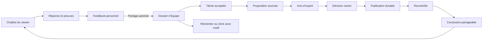

# Open Br**AI**n — spécification UX et UI

Version 2 du 16 octobre 2026. **Proposition détaillée à examiner, non implémentée et non validée par recette utilisateur.**

**Direction actualisée : [layout unifié à chat central](openbrain-chat-central.fr.md).** Sofiane demande que toute action métier soit accessible via chat, avec des boutons simples comme raccourcis. Le chat occupe la zone centrale ; le dossier de travail est à droite, repliable. Cette direction prime sur les compositions antérieures des sections 3 et 5.2. L’atlas E01–E26 conserve les contenus, droits et règles métier ; la [nouvelle maquette](mockups/openbrain-chat-central.html) illustre huit parcours dans la composition révisée. Les confirmations humaines restent requises selon le contrat métier et peuvent être exprimées dans le chat selon le contrat sécurisé de la nouvelle proposition.

## 1. Lecture du dossier et autorité

Ce dossier décrit une console de travail et un service de connaissance utilisable depuis un chatbot. Il remplace la navigation universelle centrée sur la carte par des espaces de responsabilité. L’utilisateur doit comprendre son périmètre, sa prochaine action et la conséquence de cette action sans apprendre le vocabulaire du moteur.

| Document | Usage |
|---|---|
| [Cas d’usage](openbrain-use-cases.fr.md) | Besoins exprimés, 26 UC stables, responsabilités et limites |
| Présente spécification | Architecture d’information, parcours, règles graphiques, interactions et décisions |
| [Catalogue des écrans](openbrain-screen-spec.fr.md) | Contenu, actions, états, validations et adaptation mobile de chaque écran |
| [Besoins backend et frontend](openbrain-experience-contracts.fr.md) | Modèle, droits, transitions, services, intégration et dépendances |
| [Plan de validation](openbrain-ux-validation.fr.md) | Traçabilité UC/écran/contrat, recette et portes de livraison |
| [Maquette navigable](mockups/openbrain-ux.html) | Tous les écrans de référence, thèmes, petit écran et états alternatifs ; données fictives |
| [Analyse interactive conservée](mockups/openbrain-users-use-cases.html) | Copie autonome de l’analyse précédemment présentée ; aucun choix d’atelier n’est une approbation |

Ordre d’autorité : demande explicite de Sofiane → invariants de droits/provenance/publication → catalogue des UC du 16 octobre → présente proposition → illustrations. La direction graphique de [Brain experience](brain-experience-design.fr.md#3-direction-artistique) reste applicable. Les anciennes preuves AUD/BRN ne sont ni effacées ni étendues à cette cible. Les Représentations de la section 15 restent différées. La production de cette spécification ne clôture pas l’UI/UX.

### 1.1 Exigences acquises et décisions proposées

**Demandé :** marque Open Br**AI**n ; monochrome clair/sombre ; rôles existants cumulables ; viewer dans son chatbot par MCP ; aucun A2A ; espaces contributeur/corpus manager/owner ; tâches, délégation, expertise, contrôles, sources, historique ; agents bornés ; administration technique séparée. L’accès personnel local sans saisie technique reste disponible et réversible : cette facilité ne vaut pas autorisation de supprimer l’authentification du service.

**Proposé ici :** navigation, textes, composants, délais de conception, affectation avec acceptation, revue des références par owner, clôture opérationnelle par corpus manager après preuve. Ces choix sont examinables, pas réputés approuvés. Les autorisations finales restent exécutées côté serveur.

**Hors réalisation :** aucun changement d’application, migration, compte, rôle, ACL, source privée, jeton, connecteur réel, appel modèle, déploiement ou publication. Les chiffres et noms de la maquette sont synthétiques.

## 2. Principe de service

Une réponse utile n’est pas la fin du produit. Open Br**AI**n doit permettre de comprendre la preuve, de signaler un problème, de le confier à quelqu’un, de décider, puis de vérifier la correction et d’en informer le déclarant autorisé.

Les éléments de cette chaîne sont distincts. Une acceptation de tâche n’approuve pas le savoir ; un avis favorable ne publie pas ; une publication n’atteste pas que tous les contrôles passent. Tout changement affiché doit préciser **qui agit, sur quoi, dans quelle version et avec quel effet**.

## 3. Architecture d’information

### 3.1 Entrée et contexte

L’entrée restaure la session, récupère les périmètres autorisés, puis propose une responsabilité. Avec une seule combinaison autorisée et une préférence mémorisée, elle ouvre directement l’espace correspondant. Aucun UUID, token ou endpoint dans le parcours quotidien.

Un humain choisit une **responsabilité de travail**, pas une nouvelle identité. Le rôle sélectionné simplifie l’interface ; il ne modifie ni n’étend les droits. Une même tâche conserve son identité dans tous les espaces. Une personne peut changer de responsabilité et retrouver son brouillon autorisé. Le mode agent n’est jamais une identité choisissable par un humain.

Le bandeau conserve : marque, organisation, domaine/corpus, rôle courant, recherche contextuelle, activité personnelle et profil. Le choix du domaine est toujours visible. Un lien direct autorisé prime sur la préférence d’accueil. L’entrée dans un domaine différent annonce le changement et demande quoi faire du brouillon si nécessaire.

### 3.2 Navigation par responsabilité

| Responsabilité | Accueil | Navigation principale | Actions de premier niveau |
|---|---|---|---|
| Contributeur | Mon travail | Mes tâches, Mes propositions, Explorer, Activité | Examiner une tâche, proposer une correction |
| Corpus manager | Pilotage du corpus | À qualifier, Travail d’équipe, Sources, Contrôles, Explorer, Activité | Qualifier, affecter, importer, préparer une décision |
| Owner | Mon domaine | Décisions, Objectifs et couverture, Contrôles, Équipe et accès, Explorer, Activité | Décider, déléguer une revue, prioriser |
| Admin global/technique | Exploitation | Connexions MCP, Identités de service, Incidents, Configuration, Audit technique | Tester, diagnostiquer, configurer |
| Viewer | Son chatbot | Instructions MCP, preuves et suivi dans la conversation | Questionner, vérifier, signaler, suivre |
| Agent | Pas de console à opérer | Mission/outils MCP autorisés | Prendre une mission, exécuter, restituer une limite |

Les écrans de suivi d’agents sont destinés aux humains autorisés. L’admin ne reçoit pas les documents métier au seul motif d’une fonction technique. Les pages de contrôle sont accessibles aux rôles concernés ; les actions diffèrent sans dupliquer les résultats.

### 3.3 URLs et retour

Routes cibles, pas endpoints déjà livrés : `/start`, `/work`, `/tasks/:id`, `/cases/:id`, `/proposals/:id`, `/sources/:id`, `/imports/:id`, `/controls/:id`, `/runs/:id`, `/domain`, `/coverage`, `/members`, `/explore`, `/activity`, `/missions/:id`, `/admin/connections`, `/admin/incidents`, `/admin/settings`, `/mcp-help`.

Les paramètres permis sont le périmètre opaque, le rôle d’affichage, filtres/tri, onglet, page/curseur, version et sélection autorisée. Pas de texte de conversation, jeton, extrait ni motif privé dans l’URL. Un filtre privé trop long utilise une préférence serveur autorisée. Retour restitue liste, filtre, page, sélection et position ; expiration reprend la route autorisée après identification, jamais la mutation.

### 3.4 Recherche

Recherche métier par titre, identifiant court ou concept, dans le périmètre visible. Résultats groupés « Tâches », « Propositions », « Savoir », « Sources » selon droits ; statut et contexte sur chaque résultat. Recherche littérale et sémantique doivent annoncer leur disponibilité réelle. Annuler une requête en cours ne réutilise pas son résultat dans un nouveau domaine. La navigation de résultats reste disponible sans raccourci clavier ; `Ctrl/Cmd+K` est un raccourci optionnel, jamais capturé dans un champ de saisie.

## 4. Parcours détaillés

### 4.1 Viewer : de la question à la correction suivie

1. Dans son chatbot compatible, le viewer connecte Open Br**AI**n avec son identité, choisit le domaine par son nom et découvre les capacités disponibles. L’aide n’exige pas une visite de la console.
2. Il pose une question. Le résultat distingue réponse, demande de précision, absence de savoir, contradiction et limite de service. La version du corpus et les citations restent accessibles.
3. « Montre la preuve » ouvre le passage exact et son contexte autorisé. Le chatbot distingue ce qu’il reformule de ce qu’Open Br**AI**n a retourné.
4. « Cette règle a changé » prépare un feedback explicite sur la réponse affichée. Le client montre ce qui sera transmis et le périmètre de partage ; il ne transmet pas tout l’historique par défaut.
5. Le reçu confirme l’enregistrement. Le dossier d’équipe n’existe que si le partage est autorisé. L’état personnel reste consultable même si aucun dossier collectif n’est créé.
6. « Où en est mon signalement ? » fournit état, dernière mise à jour et conclusion partageable. Sans notifications, ce suivi fonctionne par lecture à la demande.

La maquette de chatbot illustre le **contrat de présentation recommandé**, pas un chatbot propriétaire à développer. Aucun pixel identique n’est imposé aux clients tiers. La sortie structurée et les guides garantissent les informations minimales ; leur bonne restitution fait l’objet d’une qualification par client.

### 4.2 Contributeur : tâche → expertise → proposition

L’accueil commence par « À prendre en charge », « En cours », « Réponse attendue ». Une ligne montre résultat demandé, origine, priorité motivée, échéance/âge et disponibilité des preuves. L’expert ouvre le dossier, accepte ou refuse avec motif. Si une preuve est interdite, il signale le blocage ; l’affectation ne lui octroie pas ce droit.

Une tâche de correction propose « Préparer une correction ». L’éditeur juxtapose le contenu publié et le contenu proposé avec sources, motif, portée et questions affectées. Le brouillon est distinct de la proposition soumise. Le bouton principal nomme l’effet « Soumettre à la revue », jamais « Enregistrer » pour une soumission.

Une tâche de revue ouvre la révision exacte. L’expert rend un avis : favorable, modification demandée ou réserve, avec justification et références. La confirmation dit « Cet avis ne publie pas le changement ». Une modification ultérieure rend l’avis antérieur visible mais périmé. Le suivi expose la prochaine responsabilité, sans promettre un délai non défini.

### 4.3 Corpus manager : signal → dossier → délégation

La file « À qualifier » réunit uniquement les extraits partageables. La liste permet filtrer origine, âge, cible et type suspecté. Le détail sépare témoignage explicite, observation et hypothèse. Le manager qualifie la cause : connaissance, reformulation du client, accès, technique, besoin de contexte.

Il peut demander un complément, rapprocher un doublon, orienter vers l’admin ou créer une tâche. Le rapprochement conserve les événements et le plus ancien signal. L’assistant d’affectation demande objectif, résultat attendu, expert éligible, échéance et priorité motivée. La disponibilité d’une personne n’est jamais déduite d’une présence en ligne fictive. Le responsable accepte, refuse ou demande une précision ; la file de pilotage expose les demandes sans réponse et les blocages.

Le pilotage affiche les listes de travail, pas un score global de santé. Une ligne bloquée donne une action concrète : solliciter un accès, réaffecter, clarifier, arbitrer ou relancer un élément échoué. « Relancer » doit préciser son objet et ne doit pas rejouer des éléments déjà réussis.

### 4.4 Owner : décision → publication → preuve de résolution

L’owner voit les dossiers prêts à décider et ceux qui nécessitent un arbitrage. Il ouvre une proposition à révision figée : différence, sources, avis, contrôles et conflits. Les prérequis bloquants sont explicites. « Demander une modification », « Refuser » et « Différer » exigent un motif. Un report peut proposer une date de réexamen ; il ne devient pas une approbation.

« Approuver cette révision » ouvre un récapitulatif avec identité, domaine, objet, révision et effet. Une confirmation humaine indépendante est requise par le contrat existant. Le changement reste **approuvé, non publié** jusqu’à l’action de publication séparée. La publication reprend les mêmes garde-fous, le résultat durable et la relecture de version.

Une réponse réseau perdue affiche « Résultat à vérifier ». L’utilisateur vérifie le reçu ; il ne reclique pas une nouvelle publication à l’aveugle. Après publication, le recontrôle expose réussites, régressions, erreurs et cas non exécutés. Le dossier n’est clos comme « corrigé et vérifié » que si les critères attendus sont satisfaits. Une conclusion partageable est préparée pour le viewer.

### 4.5 Sources, contrôles et supervision

Import : sélectionner collection → choisir source/version → vérifier doublon, droits et format → examiner le récapitulatif → lancer → suivre par fichier → traiter les erreurs → consulter le résultat et la proposition éventuelle. Importer ne publie pas automatiquement le savoir extrait.

Contrôle : construire une banque versionnée → owner approuve la référence → choisir corpus/méthode/budget → lancer → suivre → comparer des exécutions compatibles → créer une tâche sur chaque régression pertinente. Les conclusions d’un juge IA portent méthode et incertitude ; elles ne changent pas seules une réponse officielle.

Couverture : owner définit les thèmes attendus et leurs questions. Afficher `questions vérifiées / questions attendues`, avec version et exclusions. Un thème sans objectif est « Non défini », pas couvert à 100 %. L’activité d’un thème n’est ni sa fiabilité ni sa fraîcheur. La Chronique explique les événements publiés et le travail en cours dans des filtres séparés.

### 4.6 Agents et administration

Un humain autorisé prépare une mission : périmètre, outils, livrable, budget, échéance, accès aux sources, fournisseur éventuellement autorisé, conditions d’arrêt et relecture humaine. L’agent restitue un rapport sourcé et un état ; il ne rend pas un avis humain et ne publie pas de sa propre autorité. Les écrans montrent les événements réellement reçus, sans pourcentage si le total est inconnu.

L’administration montre connectivité, disponibilité, erreurs et opérations techniques. Un test MCP utilise une fixture synthétique et publie la couverture Q/F/S/O/N/G réellement vérifiée. Les secrets sont masqués ; les diagnostics ne contiennent pas de texte du corpus. Les actions de configuration montrent leur portée, leur validation et la reprise prévue ; elles ne sont pas des boutons décoratifs sans contrat.

## 5. Direction UI et composants

### 5.1 Tokens de référence

Les valeurs ci-dessous sont une proposition de tokens produit, sans changement du CSS actuel. Le contraste effectif doit être mesuré sur tous les états, pas supposé à partir d’un nom de token.

| Token | Clair | Sombre | Usage |
|---|---|---|---|
| `canvas` | `#F5F5F5` | `#111111` | Fond général |
| `surface` | `#FFFFFF` | `#191919` | Contenu, menus et dialogues opaques |
| `surface-alt` | `#EEEEEE` | `#242424` | Zone secondaire |
| `text` | `#171717` | `#F5F5F5` | Texte et action principale |
| `text-muted` | `#595959` | `#B8B8B8` | Métadonnées lisibles |
| `divider` | `#D0D0D0` | `#474747` | Séparateur non essentiel |
| `control-border` | `#707070` | `#969696` | Champs, états et éléments identifiables |
| `action` / `on-action` | `#171717` / `#FFFFFF` | `#F5F5F5` / `#171717` | Action primaire/état choisi |
| `focus` | `#171717` | `#FFFFFF` | Contour 2 px + décalage 3 px |

Police Manrope, puis system-ui/sans-serif si indisponible. Hébergement local à prévoir ; la maquette autonome utilise le fallback si Manrope n’est pas installée et ne dépend d’aucun CDN. Nom : `Open Br<strong>AI</strong>n`, 400/700 ; ne pas mettre toute la marque en gras. Titres 32/26/20 px (desktop/page/section), texte métier 16 px, dense 14 px, métadonnées 12 px minimum, interligne 1,5 ; titres 1,2. Textes éditables mobiles 16 px minimum. Nombres alignés seulement dans les colonnes comparables.

Espacements : 4, 8, 12, 16, 24, 32, 48 px ; base 8 px, demi-pas autorisé pour alignement. Rayons 8 px contrôle, 12 px panneau ; pas d’accumulation de cartes imbriquées. Bordures 1 px, ombre réservée aux overlays. Icônes sobres 16–20 px, libellés visibles pour les actions métier. Aucun emoji comme système de statut.

Aucune couleur décorative. Les erreurs portent « Erreur », une explication et une action ; leur compréhension ne dépend pas du rouge. Signaux sémantiques optionnels uniquement dans la carte selon la convention antérieure, désactivés par défaut et toujours doublés d’un texte/signe ; aucun indicateur de poids/archive sans mécanisme réel. Ne pas ajouter cette couche dans les files de travail.

### 5.2 Gabarit et hiérarchie

Desktop ≥1200 px : navigation 216 px, corps fluide, marge 32 px, contenu principal limité à 1280 px hors carte ; panneau contextuel 320–400 px seulement si la zone restante garde au moins 640 px. De 768 à1199 px : navigation compacte ou menu, panneau en page dédiée. <768 px : navigation déroulante, en-tête sur deux lignes, listes de cartes sobres à libellés explicites, détails en page complète. À320 px, aucun défilement horizontal global.

En haut de chaque page : fil de retour, titre, description d’intention, périmètre et action principale. Ensuite état ou travail prioritaire, puis détails. Maximum quatre indicateurs utiles au premier niveau ; chaque indicateur ouvre ses objets. Les tableaux de pilotage se construisent à partir de vraies files. Pas d’illustration décorative remplaçant une action.

### 5.3 Contrats des composants

| Composant | Contenu obligatoire | Interaction |
|---|---|---|
| Ligne de tâche | Résultat demandé, état, responsable, priorité motivée, âge, échéance, blocage | Titre ouvre le détail ; aucune mutation au clic de ligne ; actions nommées |
| Statut | Libellé métier, cause si bloqué, dernier événement | Non cliquable sauf lien explicite vers détail ; ne pas présenter un tag comme bouton |
| Filtre | Label, valeur, nombre de filtres actifs, effacement | Validation cohérente, URL partageable, focus conservé, annonce du nombre de résultats |
| Liste/table | Entête sémantique, tri déclaré, pagination, total exact ou « partiel » | Tri clavier ; pas de scroll infini obligatoire ; mobile réorganise les champs |
| Fiche de preuve | Source, passage, révision/date, droit actuel, lien de contexte | Lire en entier, retour au déclencheur ; jamais remplacer une source inaccessible par du cache |
| Comparaison | Publié/proposé, changements textuels, sources, révision, impact | Lecture ligne à ligne et alternative linéaire ; ne pas utiliser seulement couleur ou barré |
| Formulaire | Labels permanents, aide avant erreur, champs requis explicités | Erreurs près des champs + résumé avec liens ; préserver les valeurs autorisées |
| Confirmation | Verbe précis, périmètre, version, conséquences, motif et identité | Annuler sans effet ; focus enfermé uniquement dans un vrai dialogue ; reprise de focus |
| Résultat de commande | Reçu, état certain/incertain, date, prochaine action | Vérifier résultat durable ; pas de succès optimiste pour droits/publication |
| Chronologie | Acteur, action, objet, date, conséquence, liens autorisés | Ordre stable, pagination, distinction événement métier/état courant |
| Notification | Type, objet, attente, destinataire, date | Ouvre le dossier ; marquer lu ne clôture rien ; pas de doublon à chaque retry |

### 5.4 Microcopie

Utiliser « Prendre en charge », « Demander une précision », « Soumettre à la revue », « Rendre un avis », « Approuver cette révision », « Publier », « Vérifier le résultat », « Préparer le retour au déclarant ». Éviter « Process », « Sync », « Commit », « Success » et les acronymes techniques hors diagnostic.

Exemples normatifs : « Votre avis est enregistré. La publication reste à décider par l’owner. » ; « Cette révision a changé depuis votre ouverture. Comparez la nouvelle version avant de décider. » ; « Nous n’avons pas reçu la confirmation de publication. Vérifiez le résultat avant de réessayer. » ; « Aucune tâche ne correspond à ces filtres. Effacer les filtres. » ; « Aucune tâche affectée. Vos futures missions apparaîtront ici. » ; « Accès indisponible. Le contenu a été masqué. »

### 5.5 Signature des attentes — Thinking Orbs

**Décision graphique de Sofiane, 16 octobre 2026 : toutes les attentes de l’interface propriétaire utilisent des variantes de [Thinking Orbs, Jakub Antalik](https://github.com/Jakubantalik/thinking-orbs).** Cette règle s’applique au chat, aux vues métier, aux boutons en cours de traitement, aux imports et aux missions d’agents. Elle remplace les spinners génériques et les points de saisie indépendants. La structure réservée d’un contenu en chargement peut rester visible autour de l’orbe.

Le projet de référence documente neuf animations monochromes, des formats 20 et 64 px, les thèmes clair/sombre et une image statique lorsque le mouvement réduit est demandé. Sa licence est MIT ; conserver les mentions requises si son code est réutilisé. Ces propriétés documentées ne constituent pas une qualification de performance ou d’accessibilité dans Open Br**AI**n. Aucun paquet n’est installé par cette décision de conception.

La correspondance suivante est notre convention produit, pas une sémantique imposée par la bibliothèque :

| Attente réelle | Variante cible | Libellé contextualisé |
|---|---|---|
| Chargement ou traitement général | `working` | « Chargement des tâches… » / « Import en cours… » |
| Recherche dans les sources autorisées | `searching` | « Recherche dans les sources du domaine… » |
| Analyse, comparaison, contrôle | `solving` | « Comparaison des deux révisions… » |
| Synthèse de plusieurs sources | `weaving` | « Synthèse des passages retrouvés… » |
| Rédaction ou génération de réponse | `composing` | « Rédaction de la proposition… » |
| Connexion ou rétablissement de session | `connecting` | « Connexion au corpus… » |
| Structuration d’un résultat | `shaping` | « Préparation du tableau de résultats… » |
| Écoute vocale effectivement activée | `listening` | « Écoute en cours — Arrêter » |
| File d’attente, pause ou décision humaine attendue | Variante statique de `breathing` | « En file d’attente » / « Votre validation est requise » |

**Grammaire commune chat + UI.** Une même opération conserve son identifiant, son état et son libellé dans les deux surfaces. La phase est issue d’un événement d’exécution réel ; ne pas enchaîner des animations pour simuler des étapes. Si seule l’activité globale est connue, utiliser `working` avec un libellé général. L’orbe ne représente ni un pourcentage, ni la fiabilité d’une réponse, ni une pensée interne observable.

**Placement.** Format 20 px dans une ligne, un bouton ou une étape ; format 64 px pour l’activité principale d’un tour de conversation ou d’une vue vide en chargement. Un seul indicateur animé principal par opération visible ; les listes de nombreuses missions utilisent des états textuels et des orbes statiques, avec animation de la mission consultée. Pas d’écran bloquant pour un traitement que l’utilisateur peut laisser en arrière-plan.

**Information et contrôle.** Toujours associer un libellé visible. Pour une opération longue : phase confirmée, dernier événement, volumes et total seulement s’ils sont connus, accès au détail et annulation si elle est réellement prise en charge. Une progression mesurée accompagne l’orbe ; elle ne lui est pas substituée par une estimation fictive. Une opération échouée, terminée, interrompue ou au résultat incertain arrête l’animation et expose son état et sa prochaine action. L’attente d’une validation humaine reste statique avec le bouton de décision accessible.

**Accessibilité et thèmes.** Noir/blanc/gris exclusivement, contraste contrôlé dans les deux thèmes, mouvement réduit entièrement statique. Le texte de statut porte l’information accessible ; masquer l’orbe décorative aux technologies d’assistance pour éviter une annonce en double. Annoncer les changements de phase sans répéter chaque image ou chaque jeton. Préserver le focus et la place du composant ; arrêter les animations hors écran ou onglet masqué.

**Limite MCP.** Cette signature s’impose à notre interface et peut être proposée aux clients compatibles. Un chatbot externe conserve son propre rendu ; transmettre les états structurés et leurs libellés, sans rendre l’usage du corpus dépendant du support d’une animation.

**Recette future.** Vérifier les phases réelles, attente humaine, erreur, annulation, reprise, mouvement réduit, clair/sombre, 320 px et lecteurs d’écran ; mesurer le coût de plusieurs opérations visibles. L’atlas initial reste antérieur à cette décision ; la nouvelle proposition à chat central en illustre une interprétation vectorielle, sans intégrer la bibliothèque. Cette modification ne développe pas l’application.

## 6. États et continuité

| État transversal | Affichage et action | Règle de données |
|---|---|---|
| Chargement initial | Structure stable, message « Chargement… », pas de faux chiffres | Annuler requête après changement de contexte |
| Rafraîchissement | Dernier résultat autorisé et heure, progression discrète | Revalider les droits avant de conserver un cache sensible |
| Vide | Distinguer premier usage, zéro résultat et aucun droit | Aucun compte à zéro si non calculé |
| Partiel | « X éléments chargés », raison, poursuivre/reprendre | Curseur et complétude fournis par serveur |
| Échec temporaire | Message utile et réessai de lecture | Aucun réessai automatique de commande |
| Session expirée | Contenu privé masqué, rétablir accès, route conservée | Vider les caches ; brouillon selon politique explicite d’identité |
| Accès retiré | Masquer immédiatement, autre périmètre possible | Pas de titre/compteur/notification résiduel interdit |
| Conflit | Comparer version de départ et actuelle, conserver brouillon autorisé | Nouvelle décision/revue sur nouvelle révision |
| Résultat incertain | Reçu/opération à vérifier, bouton de vérification | Même clé de commande ; lecture avant nouveau travail |
| Hors ligne | Afficher indisponibilité ; brouillon en mémoire si autorisé | Pas de file de publications différées ; pas de contenu sensible en localStorage |
| Annulation | Effet et éléments déjà traités explicités | Annuler une exécution n’efface pas résultats/source/historique |

Un brouillon ne doit jamais porter « enregistré » avant accusé durable. Avant le contrat de brouillons serveur, afficher « Non sauvegardé — dans cet onglet ». Après contrat, sauvegarde versionnée et horodatée. Quitter un brouillon modifié sans sauvegarde demande conserver/abandonner/rester. Un retrait de droit prime sur la restauration du brouillon ; pas de réapparition à la connexion d’une autre personne.

## 7. Accessibilité et comportement adaptatif

Cible WCAG2.2 AA, à vérifier. Contraste texte 4,5:1, grands textes3:1, composants/focus3:1 ; ne pas substituer ces chiffres à une mesure. Cibles tactiles produit44×44 px, plus exigeantes que le minimum24 px assorti d’exceptions de WCAG2.2. Reflow320 CSS px et zoom200/400 % ; focus visible et non masqué ; aucun geste de glisser requis pour accomplir une tâche. [WCAG2.2](https://www.w3.org/TR/WCAG22/).

Structure : un h1 par écran, navigation nommée, lien d’évitement, landmarks, labels de champs, tables sémantiques. Changement de page : titre document et focus sur le titre via une technique d’accessibilité à implémenter. Mise à jour locale : focus conservé, résumé `aria-live=polite`. Erreur de formulaire : résumé focalisé ; contenu de l’erreur relié au champ. Dialogues : Échap, piège de focus, retour au contrôle ; pas de dialogues imbriqués.

Mobile : accès aux preuves et différence intégrale, sans miniaturiser deux colonnes. Les actions de décision restent accessibles mais jamais collées au bas au prix d’un contenu masqué. Carte : liste équivalente, zoom +/− et déplacement accessibles, bouton retour à la sélection ; gestes tactiles facultatifs. Mouvement réduit : pas de transition spatiale animée. Les transitions sont finies ; les orbes d’activité ne bouclent que pendant une exécution confirmée, selon §5.5.

## 8. Décisions encore nécessaires

Les sélections de l’artefact précédent ne sont pas une validation ; aucun choix reçu ne permet d’adopter silencieusement une politique.

| ID | Arbitrage | Recommandation de conception | Conséquence à valider |
|---|---|---|---|
| D01 | Affectation directe ou acceptation | Affectation proposée puis acceptation/refus explicite | Qui relance, quel délai, que faire d’une absence ? |
| D02 | Partage des signaux | Résumé minimal explicitement partageable ; conversations restent privées | Destinataires, retrait, conservation des extraits et traces d’audit |
| D03 | Références officielles | Préparation manager/expert, approbation owner versionnée | Politique d’indépendance auteur/approbateur et suppléance |
| D04 | Délais | Échéances explicites par mission ; aucune SLA implicite | Priorités, escalade et absences avant notifications automatiques |
| D05 | Clôture | Manager clôt le traitement ; owner garde la décision/publication | Preuve de recontrôle, motif sans correction, droit de rouvrir |
| D06 | Pilote | Viewer→signal partagé→expert→owner→retour, un domaine synthétique | Choisir le client MCP compatible et les participants réels |
| D07 | Multi-rôle | Plusieurs rôles explicites par domaine, union contrôlée des capacités | Restrictions, séparation des tâches, migration des memberships |
| D08 | Admin global | Administration technique distincte de la propriété métier | Portée plateforme/tenant, actions élevées et audit |
| D09 | Conservation | Rétention configurable séparée pour signaux, extraits, brouillons et audit | Durées à fixer ; pas de durée inventée par la maquette |
| D10 | Confirmation humaine | Réutiliser la frontière indépendante existante | Produit de confirmation, UX de retour et environnement pilote |

Aucune décision ci-dessus n’est un prétexte pour bloquer la lecture ou la validation de la maquette. En revanche, un contrat d’accès, partage ou confirmation doit être arrêté avant l’implémentation dépendante.

## 9. Principes de conception documentés

Les choix restent propres à Open Br**AI**n. Les références donnent des principes et non une preuve de validation du produit :

- La visibilité de l’état, la prévention des erreurs, la cohérence et la reconnaissance plutôt que la mémorisation guident les reçus, les actions nommées et le contexte persistant. [NN/g, heuristiques d’utilisabilité](https://www.nngroup.com/articles/ten-usability-heuristics/).
- Une liste de tâches aide un travail réparti sur plusieurs sessions et permet de choisir l’ordre. Un import séquentiel utilise des étapes, pas une checklist arbitraire. [GOV.UK, Task list](https://design-system.service.gov.uk/components/task-list/).
- Un récapitulatif modifiable précède la confirmation d’une action conséquente. L’utilisateur peut corriger son choix sans ressaisir tout le formulaire. [GOV.UK, Check answers](https://design-system.service.gov.uk/patterns/check-answers/).
- Les responsabilités visibles, opérations en arrière-plan et preuves de résultat sont liés dans une même chaîne de service. [NN/g, Service blueprints](https://www.nngroup.com/articles/service-blueprints-definition/).

## 10. Séquence proposée et sortie de conception

1. Valider responsabilités/D01–D10 et navigations avec un représentant de chaque rôle humain.
2. Prototyper et tester la boucle minimale ; le présent mockup permet la discussion, pas une recette de backend.
3. Contractualiser les besoins B01–B12 et les états d’erreur avant de brancher les écrans.
4. Livrer par parcours vertical avec preuve navigateur et MCP, puis étendre sources, contrôles, supervision, agents et administration.
5. Conserver les lots AUD/BRN de fiabilité et performances ; ne pas annoncer une capacité10 000 à partir de la maquette.

L’acceptation de la spécification, la validation d’un prototype, la livraison fonctionnelle et la clôture UI/UX sont quatre événements différents. Aucun n’est déduit des trois autres.
